<div align="center">

# 🇹🇼 autonomous.tw

**資訊自主。真實可溯。不受語言限制的第一手新聞。**

[](LICENSE)
[](https://github.com/astral-sh/uv)
[](http://makeapullrequest.com)

<br>


📡 以本地 LLM 優先的 AI 新聞雷達。每日產出繁體中文綜合新聞簡報，涵蓋 AI 科技、台灣時事、國際政治、體育與知識管理。

> *Inspired by [Horizon](https://github.com/Thysrael/Horizon) — autonomous.tw evolves the original linear pipeline toward a multi-agent collaborative workflow with enhanced localization for Traditional Chinese (Taiwan) users.*

</div>

## Why autonomous.tw?

台灣每日受到大量垃圾新聞淹沒，真正重要、可溯源的資訊反而難以被看見。`autonomous.tw` 的使命是：

- **打破語言障礙**：自動將全球重要資訊轉化為繁體中文，讓台灣讀者不受語言限制讀到第一手真實資訊。
- **透明溯源**：每則新聞都保留完整的來源鏈，讓讀者能追溯資訊從何而來。
- **本地 LLM 優先**：優先使用本地 Ollama 模型進行分析，保護資料主權並節省 API 費用。
- **多元視角**：不只是單一來源的摘要，而是匯集多個社群、媒體對同一事件的觀點與討論。

## Features

- **📡 多來源監控** — 追蹤 Hacker News、RSS、Reddit、Telegram、Twitter/X、GitHub 以及 Threads 等社群平台
- **🤖 本地 AI 優先** — 預設使用 Ollama 本地模型（推薦 Gemma4:12B），雲端 API 為備援方案
- **🔗 語義去重** — 跨平台合併相同事件的不同報導，不再看到重複新聞
- **🔍 深度背景補充** — 為重要新聞自動搜尋網路背景資料，幫助讀者理解上下文
- **💬 社群討論摘要** — 收集並總結 Hacker News、Reddit 等平台的社群討論
- **🌐 繁體中文輸出** — 使用台灣慣用語彙，確保 Pangu 排版規則（中文與英數之間自動空格）
- **📝 卡片式 UI** — 頭條新聞 + 重大新聞卡片 + 列表瀏覽，支援 RWD 響應式設計
- **📅 日曆導航** — 查閱過往新聞簡報
- **🏷️ Tag 分類** — AI 科技、台灣時事、國際政治、體育、知識管理等五大領域標籤
- **📧 多管道推送** — GitHub Pages、Email、Webhook（Feishu/Slack/Discord）
- **🐳 Docker 一鍵部署** — docker-compose + crontab 定時自動執行

## Quick Start

### 1. 環境準備

**推薦方式：本地 Ollama + Docker**

```bash
# 安裝 Ollama（macOS）
brew install ollama

# 下載推薦模型
ollama pull gemma3:12b
```

### 2. 安裝與設定

```bash
git clone https://github.com/WolfgangYu/autonomous.tw.git
cd autonomous.tw

# 複製設定檔
cp .env.example .env
cp data/config.example.json data/config.json

# 編輯 config.json — 將 ai.provider 設為 "ollama"
# 編輯 .env — 填入雲端 API 金鑰（作為 Ollama 失敗時的備援）
```

**最簡設定（僅使用本地 Ollama）：**

```jsonc
{
  "ai": {
    "provider": "ollama",
    "model": "gemma3:12b",
    "base_url": "http://localhost:11434/v1",
    "api_key_env": "OLLAMA_API_KEY",
    "languages": ["zh", "en"]
  },
  "sources": {
    "hackernews": { "enabled": true },
    "rss": [
      { "name": "BBC News", "url": "https://feeds.bbci.co.uk/news/rss.xml" }
    ]
  },
  "filtering": {
    "ai_score_threshold": 6.0,
    "time_window_hours": 24
  }
}
```

### 3. 執行

```bash
# 本機開發
uv sync
uv run autonomous-tw --hours 24

# 或者使用互動式設定精靈
uv run autonomous-tw-wizard

# Docker 部署
docker compose up -d
```

### 4. Ollama 設定詳解

`autonomous.tw` 預設以本地 Ollama 為第一優先，雲端 API 僅在 Ollama 無法使用時自動切換。

**安裝 Ollama：**
```bash
# macOS
brew install ollama

# Linux
curl -fsSL https://ollama.com/install.sh | sh

# 啟動服務
ollama serve
```

**推薦模型：**
```bash
# 輕量高效（建議記憶體 ≥ 16 GB）
ollama pull gemma3:12b

# 更高品質（建議記憶體 ≥ 32 GB）
ollama pull qwen3:14b
ollama pull llama3.1:8b
```

**設定 config.json 使用 Ollama：**
```jsonc
{
  "ai": {
    "provider": "ollama",
    "model": "gemma3:12b",
    "base_url": "http://localhost:11434/v1",
    "api_key_env": "OLLAMA_API_KEY"
  }
}
```

> 💡 Ollama 預設在 `localhost:11434`，如果在 Docker 中執行 autonomous.tw，需將 `base_url` 設為 `http://host.docker.internal:11434/v1`

**雲端備援設定：**
當 Ollama 因故無法回應時，autonomous.tw 會自動嘗試雲端 API。只需在 `.env` 中設定對應的金鑰：
```bash
ANTHROPIC_API_KEY=sk-ant-...     # Claude 備援
OPENAI_API_KEY=sk-...            # GPT 備援
```

### 4. 自動化排程

Docker 容器內建 crontab，每 6 小時自動執行一次，並將結果推送到 GitHub Pages。詳見 [Docker 部署指南](docs/docker.md)。

## 架構設計

```mermaid
flowchart LR
    subgraph sources["資料來源"]
        rss["📡 RSS"]
        hn["📰 Hacker News"]
        reddit["💬 Reddit"]
        telegram["✈️ Telegram"]
        twitter["🐦 Twitter/X"]
        github["🐙 GitHub"]
        threads["🧵 Threads"]
    end

    subgraph agents["Multi-Agent 協作層"]
        dispatcher["🎯 Dispatcher Agent"]
        specialist["👥 Specialist Agents"]
        synthesizer["🧠 Synthesizer Agent"]
    end

    subgraph outputs["輸出"]
        site["🌐 GitHub Pages"]
        email["📧 Email"]
        webhook["🔔 Webhooks"]
    end

    sources --> dispatcher
    dispatcher --> specialist
    specialist --> synthesizer
    synthesizer --> outputs
```



## 與 Horizon 的差異

| 特性 | Horizon (上游) | autonomous.tw |
|------|---------------|---------------|
| 架構 | 線性 Pipeline | Multi-Agent 協作 |
| 語言 | 簡體中文 + 英文 | 繁體中文（台灣用語） |
| LLM 優先級 | 雲端 API | 本地 Ollama 優先 |
| 新聞領域 | 科技為主 | AI 科技、台灣時事、國際政治、體育、知識管理 |
| UI | 列表式 | 卡片式（頭條 + 重大 + 列表） |
| 社群來源 | 8 種 | 8 種 + Threads |
| 去重 | URL + 簡易語義 | 深度語義合併 |
| 部署 | Docker + GitHub Actions | Docker Compose + Crontab |

## 支援的 AI 模型

| Model | Type | Notes |
|-------|------|-------|
| **Ollama + Gemma3:12B** | 本地 (推薦) | 零成本、資料不外流 |
| **Claude (Anthropic)** | 雲端 | 最佳品質備援 |
| **GPT (OpenAI)** | 雲端 | 相容 API |
| **Gemini (Google)** | 雲端 | 免費額度可用 |

## 授權

[MIT](LICENSE) — Inspired by [Horizon](https://github.com/Thysrael/Horizon)